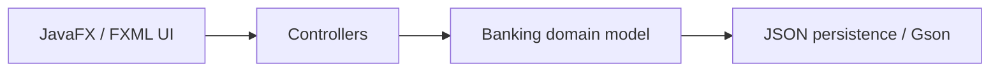

# Banking Desktop Application

A JavaFX banking simulation developed for the Object-Oriented Software Development (OOS) course at FH Aachen. The application manages simulated bank accounts and transactions, demonstrating object-oriented design, custom exceptions and JSON persistence.

## Features

- Create, view and delete simulated bank accounts from a JavaFX desktop interface.
- Record and display payment and transfer transactions.
- Model transaction types with inheritance and polymorphism (`Transaction`, `Payment`, `Transfer`, `IncomingTransfer`, `OutgoingTransfer`).
- Store accounts and their transactions in local JSON files via Gson.
- Handle duplicate accounts, invalid transactions, and other domain errors through custom exceptions.

## Tech stack

- Java 17
- JavaFX 19 / FXML
- Maven
- Gson (JSON persistence)

## Architecture



## Run locally

**Requirements:** JDK 17 and Maven installed. A desktop environment is required for the JavaFX UI.

1. Clone this repository.
2. Open a terminal in the repository root (the directory containing `pom.xml`).
3. Run:

   ```bash
   mvn clean javafx:run
   ```

Or open the Maven project in IntelliJ IDEA, allow Maven to download dependencies, and run `ui.FxApplication`.

The project stores demonstration account data under the local `data/` folder relative to the current working directory. This data is deliberately **not committed** to the repository to avoid publishing users' local records. The application creates its working folders as needed.

## Project structure

```text
src/main/java/bank/       Domain objects and account / transaction logic
src/main/java/ui/         JavaFX controllers and entry point
src/main/resources/      FXML layouts
data/                    Local JSON files at runtime (ignored by Git)
```

## Coursework context

The repository presents the **Praktikum 5 desktop application** from a broader sequence of OOS university exercises. Earlier exercises (P1–P4) and their JUnit tests are retained in the original coursework archive and are **not** part of this cleaned, runnable P5 repository. The project was developed as coursework; it should not be described as an independently commissioned product.

The repository contains implementation code and UI layouts rather than the original university assignment PDFs.

## Limitations

This is a learning project. It has no real authentication, server-side database, online banking functionality, or production-grade security controls. Automated tests for this final JavaFX module have not been verified; older coursework contained JUnit tests.
